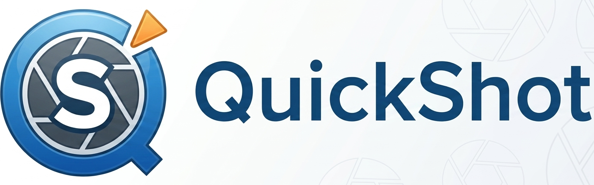

<p align="center">
  
</p>

# <p align="center">QuickShot 📸</p>

<p align="center">
  <strong>Capture. Crop. Copy. Done.</strong><br>
  A lightweight Chrome extension for taking quick, distraction free screenshots.
</p>


<p align="center">
  
</p>


## Features

-   📸 Select any area of the current webpage
-   🌑 Dimmed overlay for precise selection
-   ✨ Live selection preview
-   📋 Copy screenshots directly to your clipboard
-   💾 Download screenshots as PNG
-   🎥 Record your screen
-   ▶️ Preview recordings before saving or sharing them
-   🗂️ Browse and manage saved recordings in history
-   ⚙️ Customize settings (themes and automatic copy/download
    options)
-   🌗 Light and dark theme support
-   ❌ Press `Esc` anytime to cancel
    screenshot selection
-   ⚡ Lightweight and fast
-   🔒 Works locally (no uploads or tracking)

---

## Installation

Since QuickShot isn't published on the Chrome Web Store yet, install it manually.

1. Clone this repository

```bash
git clone https://github.com/YOUR_USERNAME/quickshot.git
```

2. Open Chrome and go to:

```
chrome://extensions
```

3. Enable **Developer mode**.

4. Click **Load unpacked**.

5. Select the project folder.

6. Pin the extension from Chrome's toolbar.

You're ready to go.

---

## Building from Source

QuickShot uses [esbuild](https://esbuild.github.io/) to bundle and minify the source files.

1. Install dependencies:

```bash
npm install
```

2. Build the extension:

```bash
npm run build
```

Output goes to the `dist/` folder. Load this folder as an unpacked extension in Chrome.

3. Watch for changes during development:

```bash
npm run watch
```

The built extension in `dist/` is self-contained — you don't need the source files to use it.

---

## Usage

### Take a screenshot

1.  Click the **QuickShot** extension icon.
2.  Choose **Screenshot**.
3.  Drag to select the area you want to capture.
4.  Release the mouse.
5.  Copy the screenshot to your clipboard, download it, or cancel.

### Record your screen

1.  Open QuickShot and choose **Record**.
2.  Choose the available recording options and start recording.
3.  Pause, resume, or stop the recording using the recorder controls.
4.  Preview the result and download it when you're happy with it.

### Manage recordings

Open **History** to browse saved recordings, search and filter them, and
use the available actions to preview, download, rename, or delete items.

### Customize QuickShot

Open **Settings** to adjust your preferences, including theme and
automatic copy/download options.

---

## Built With

* HTML
* CSS
* JavaScript
* Chrome Extension Manifest V3
* Chrome Extension APIs
* Canvas API

---

## Roadmap

-   [x] Area selection
-   [x] Live selection preview
-   [x] Download screenshots
-   [x] Copy to clipboard
-   [x] Cancel with Escape
-   [x] Settings page
-   [x] Theme support
-   [x] Screen recording
-   [x] Recording preview and history
-   [ ] Annotation tools
-   [ ] MP4 export

---

## Contributing

Found a bug or have an idea?

Feel free to open an issue or submit a pull request.

---

## License

MIT

---

<p align="center">
Made with ☕ and too many mouse events.
</p>
